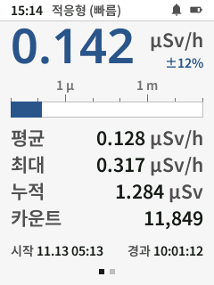
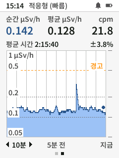

# Bosean FS-5000: Overview Screen

On the Bosean FS-5000 (Korean build), Rad Pro shows a single measurement screen with two pages instead of separate instantaneous, average, cumulative and history views.

## Title Bar

The 24 px title bar shows the time (hidden while the clock is not set), the instantaneous averaging mode (for example *적응형 (정밀)*, adaptive precision) and the status icons (pulse sound, lock, alert, battery). If there is not enough room, the averaging mode is hidden. Other screens show their title instead.

## Page 1: Values

* **Instantaneous rate** with its confidence interval and unit.
* **Logarithmic bar**: each step is a 10× increase. Replaced by *고장* (fault) when the tube is faulty.
* **Average**, **maximum**, **cumulative dose** and **counts**. The average turns to the accent colour when the averaging period has finished; the cumulative dose takes the warning or alarm colour when a dose alert is active.
* **Start** (when the cumulative dose was last reset, or when a valid clock first became available) and **elapsed** measurement time. The start time shows `--` until the clock has been set. Elapsed time only counts while the device is on, so start + elapsed may differ from the current time.

## Page 2: History

* **Instantaneous** and **average** rate (labels include the unit), and the instantaneous rate in the **secondary unit**.
* **Average time** and the average's **confidence interval**.
* **History graph** on a logarithmic 1-2-5 scale: gridlines are labeled (a label is skipped if it would overlap another), the top label carries the unit, warning and alarm levels are drawn as dashed lines, and a dot marks the latest value.
* **Time axis**: the selected period, the half-way point and *지금* (now). Periods: 10 minutes, 1 hour, 1 day, 1 week, 1 month, 1 year.

## Controls

| Action | Key |
|---|---|
| Switch page | Press OK |
| Change history period (page 2) | Press Up / Down |
| Reset instantaneous rate, maximum and average / dismiss alerts | Long hold Up |
| Reset cumulative dose (dose, counts and start time) | Settings > Measurements > Cumulative dose > Reset |
| Open settings | Short hold Down |
| Power on/off | Long hold OK |
| Toggle lock mode | Long hold Up + OK |
| Toggle pulse sound | Long hold Up + Down |

The screen starts on page 1 with the 10-minute period after power-on. When a rate or dose alert turns the display on, page 1 is shown.

## Settings Storage

Settings and the cumulative dose start time are saved to flash within a second of any change. The cumulative dose and tube life are also saved at those moments and on a normal power-off.

Updating with `update.bat` / `update.sh` keeps these settings and the data log; `install.bat` / `install.sh` erases them. After flashing, if the USB cable is connected, the installer sets the device clock and time zone from the computer.

## Defaults

* Instantaneous averaging: adaptive precision
* Display theme: dusk
